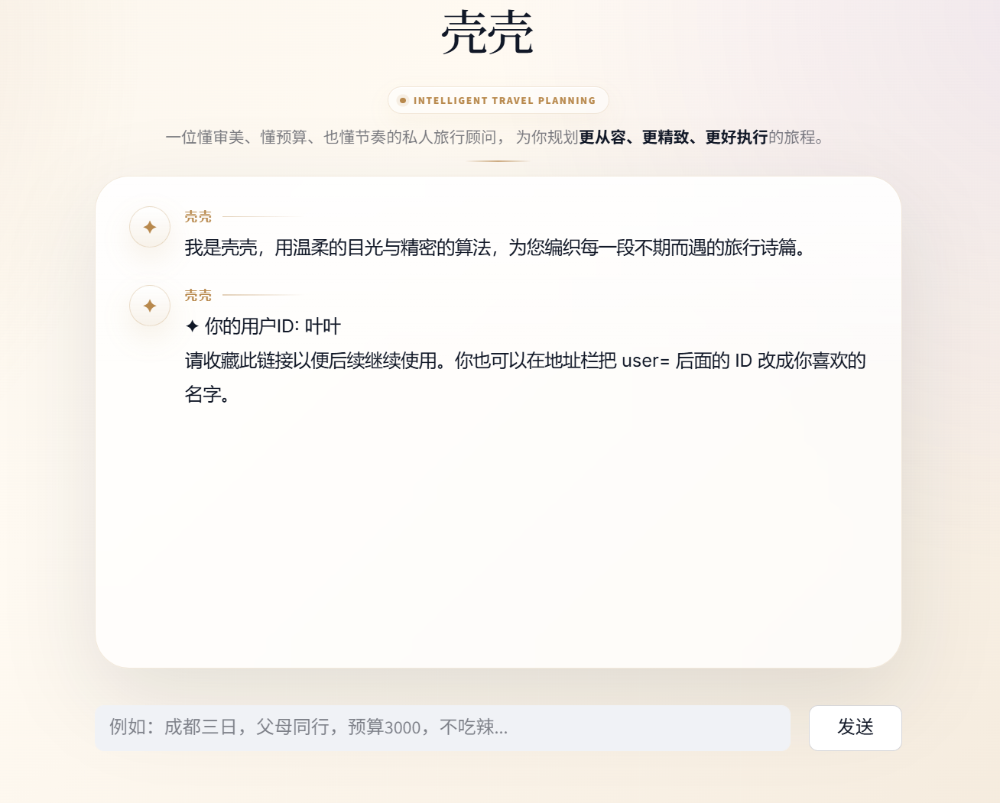

# Keke Travel Planner

An individual undergraduate coursework project that uses the DeepSeek API to generate travel suggestions through a Python / Streamlit web interface.

The project was completed by Shenghao Ye with AI assistance in code development. It is an application prototype, not a research result or a claim of independently writing every line of code.

[中文说明](README.zh-CN.md)

## Coursework interface

This image was extracted unchanged from slide 4 of the original coursework presentation, 壳壳-叶圣颢.pptx. It shows the introductory desktop interface, not a newly captured run or an evaluated travel-plan result. See [media notes](docs/MEDIA_SOURCES.md).

## Features

- Travel-plan suggestions and questions about attractions, food, transport and budgets.
- Keyword-based preference extraction and SQLite storage.
- Multiple conversation windows, history review and continuation.
- Local travel-reference lookup by an exact city name.
- CSS layouts for desktop and narrow screens.

## Run locally

Use Python 3.10 or later. From the repository root:

~~~powershell
python -m venv .venv
.venv\Scripts\python.exe -m pip install -r requirements.txt
Copy-Item .env.example .env
~~~

Edit .env locally and fill in LLM_API_KEY. Then:

~~~powershell
.venv\Scripts\python.exe run.py
~~~

Open the local URL printed by Streamlit, normally http://localhost:8501.
On macOS/Linux, use .venv/bin/python and copy .env.example with cp.

The application loads .env from the repository directory. Process environment variables take priority. LLM_BASE_URL and LLM_MODEL can also be configured. DEEPSEEK_API_KEY is accepted as an alternative to LLM_API_KEY.

A new local database at src/data/memory.db is created on first initialization. Original chat histories and user preference records are not distributed.

Opening the application sends a greeting request to the configured API; submitting a question normally sends requests for intent classification and response generation. Live use requires an available model, internet access and the provider's API account.

The default model name is deepseek-flash, following the [DeepSeek API quick start](https://api-docs.deepseek.com/). Model availability may change.

## Project structure

    run.py                      Launcher
    src/ui/app.py               Streamlit interface
    src/agent/orchestrator.py    Conversation flow and reference lookup
    src/llm/llm_service.py       API configuration and calls
    src/memory/user_memory.py   Preference and conversation storage
    src/data/*.json              Coursework reference examples
    tests/                      Offline checks using mocked API calls

## Scope and limitations

- Local JSON files were assembled through AI-assisted web searching and organization for the coursework, as reported by the author. Exact source URLs and collection dates were not retained; details and prices have not been independently verified. They are static demonstration references, not authoritative travel information.
- Lookup is exact city-name filtering, without embeddings or a vector database. The current response path reads attraction and restaurant data; transport and travel-tip files are included but are not retrieved by that path.
- User IDs in URL parameters separate records, but there is no login or authorization system. Anyone who knows an ID can use it. Use this prototype locally for demonstration, not for storing private information on a public server.
- Response generation receives a shortened history summary. It does not resend the complete conversation transcript.
- API exceptions currently fall back to an empty result. Better error reporting and evaluation remain future work.
- No experiments establish planning quality, factual accuracy or improvements over another system. Mobile-specific CSS exists; device compatibility has not been comprehensively tested.

## Checks

~~~powershell
python -m unittest discover -s tests -v
~~~

The tests use mock responses and temporary databases. They make no live API calls and do not evaluate the quality of real model output. See [verification notes](docs/VERIFICATION.md).

## Authorship and references

This was individual coursework for 人工智能技术应用与实践. The student was responsible for completing the submitted project, and used AI for code development. That statement does not imply line-by-line independent coding or full mastery of every library.

The repository preparation changes are recorded separately in [PREPARATION.md](docs/PREPARATION.md). The project uses [Streamlit](https://docs.streamlit.io/), the [OpenAI Python client](https://github.com/openai/openai-python) for compatible API calls, [DeepSeek](https://api-docs.deepseek.com/), and Python's SQLite interface.

No project-wide open-source license has been selected. Dependencies retain their own licenses. Data provenance should be reviewed before broad redistribution.
